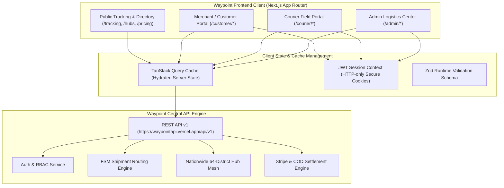

# 🚀 Waypoint — Next-Generation Logistics & Supply Chain Operating System

[](https://nextjs.org/)
[](https://react.dev/)
[](https://tailwindcss.com/)
[](https://tanstack.com/query)
[](https://www.typescriptlang.org/)
[](https://ui.shadcn.com/)
[](https://zod.dev/)
[](https://opensource.org/licenses/MIT)

---

## 🔗 Live Demo & Links

- 🌐 **Live Application Demo:** [https://web-waypoint.vercel.app](https://web-waypoint.vercel.app)
- 📡 **Central Backend API (v1):** [https://waypointapi.vercel.app/api/v1](https://waypointapi.vercel.app/api/v1)
- 📦 **GitHub Repository:** [https://github.com/sumon-chandra/waypoint](https://github.com/sumon-chandra/waypoint)
- 🔍 **Live Public Tracking:** [https://web-waypoint.vercel.app/tracking](https://web-waypoint.vercel.app/tracking)

---

## 📖 Project Description

**Waypoint** is an enterprise-grade, high-velocity logistics and parcel delivery frontend engineered to streamline nationwide e-commerce distribution and freight forwarding across Bangladesh.

Built with **Next.js 16 (App Router)**, **React 19 Server & Client Components**, **Tailwind CSS v4**, and **TanStack Query v5**, Waypoint bridges merchants, hub operators, field couriers, and end recipients into a single unified operating system. The platform eliminates transit blind spots, automates parcel batching, enforces tamper-proof doorstep Cash on Delivery (COD) collection via 4-digit verification OTPs, and provides transparent visibility across all **64 districts** and **8 administrative divisions**.

---

## 📌 Project Overview & Architectural Vision

### The Core Problems Waypoint Solves

1. **Fragmented Visibility:** Traditional courier services suffer from disconnected tracking checkpoints. Waypoint delivers an immutable, node-by-node audit trail from consignment booking through last-mile recipient handover.
2. **Doorstep Delivery Discrepancies & Fraud:** Replaces unverifiable delivery claims with cryptographically verified 4-digit recipient OTP handshakes and strict cash reconciliation checks before completing consignments.
3. **Intra-District vs. Inter-District Routing Friction:** Implements an adaptive **Finite State Machine (FSM)** that dynamically branches between localized intra-city drops (5 active stages) and cross-divisional highway linehaul cargo (8 active stages).
4. **Merchant Cash Settlement Delays:** Offers transparent automated billing clarity, COD transaction ledgers, digital prepayment options powered by Stripe, and real-time shipping rate estimators.



---

## 🌟 Feature Lists

### 1. Adaptive Dual-Route Finite State Machine (FSM)

Shipments follow an immutable 9-state Finite State Machine. The frontend stepper dynamically branches based on the parcel's `deliveryType`:

```mermaid
flowchart TD
    subgraph LocalFSM ["LOCAL Route (Intra-Hub / Intra-City — 5 Active Steps)"]
        L1[PENDING] --> L2[ASSIGNED]
        L2 --> L3[PICKED_UP]
        L3 --> L4[RECEIVED_AT_ORIGIN_HUB]
        L4 -->|Direct Neighborhood Route| L5[OUT_FOR_DELIVERY]
        L5 --> L6[DELIVERED]
    end

    subgraph InterFSM ["INTER_DISTRICT Route (Multi-Hub Highway Linehaul — 8 Active Steps)"]
        I1[PENDING] --> I2[ASSIGNED]
        I2 --> I3[PICKED_UP]
        I3 --> I4[RECEIVED_AT_ORIGIN_HUB]
        I4 -->|Highway Linehaul Cargo| I5[IN_TRANSIT]
        I5 -->|Regional Terminal Sorting| I6[RECEIVED_AT_DEST_HUB]
        I6 --> I7[OUT_FOR_DELIVERY]
        I7 --> I8[DELIVERED]
    end
```



#### Canonical Shipment Status Breakdown:

| Status Key               | Human Label         | Badge Presentation | Lifecycle Description                                                              |
| :----------------------- | :------------------ | :----------------- | :--------------------------------------------------------------------------------- |
| `PENDING`                | Order Placed        | Amber / Secondary  | Consignment registered; awaiting courier assignment. Can be cancelled by customer. |
| `ASSIGNED`               | Courier Assigned    | Blue / Outline     | First-mile courier partner assigned for doorstep pickup.                           |
| `PICKED_UP`              | Parcel Collected    | Sky / Default      | Merchant consignment picked up by courier rider.                                   |
| `RECEIVED_AT_ORIGIN_HUB` | At Origin Hub       | Amber / Muted      | Scanned into local distribution hub for barcoding and batching.                    |
| `IN_TRANSIT`             | In Linehaul Transit | Indigo / Accent    | Highway freight linehaul moving across divisional borders _(Inter-district only)_. |
| `RECEIVED_AT_DEST_HUB`   | At Destination Hub  | Purple / Secondary | Received and sorted at recipient's divisional destination terminal.                |
| `OUT_FOR_DELIVERY`       | Out for Delivery    | Orange / Default   | Last-mile courier dispatched with 4-digit recipient verification OTP.              |
| `DELIVERED`              | Delivered           | Emerald / Success  | Recipient OTP verified and COD collected. Handover terminal state.                 |
| `CANCELLED`              | Cancelled           | Red / Destructive  | Order terminated with audit reason recorded. Terminal state.                       |

---

### 2. Comprehensive Role-Based Portals

#### 👤 Customer & Merchant Portal (`/customer`)

- **Interactive KPI Dashboard:** Total spend, parcel count, active in-transit shipments, success rates, and COD receivables.
- **Smart Parcel Booking Engine:** Form with dimensions, actual weight (kg), delivery type (`LOCAL` / `INTER_DISTRICT`), fragile cargo flags, and pickup scheduling.
- **Flexible Settlement Options:** Seamless toggle between prepaid digital payment (Stripe Checkout Session) and automated Cash on Delivery (COD).
- **Consignment Ledger & Live Filtering:** Searchable list with status filters, tracking links, and printable waybills.
- **Controlled Cancellation:** Cancellation modal requiring audit reason logging for orders in `PENDING` status.

#### 🛵 Courier Partner Portal (`/courier`)

- **Daily Run-Sheet Manifest:** Real-time list of assigned first-mile pickups and last-mile doorstep deliveries.
- **One-Tap State Transitions:** Quick actions (`Pickup Confirmed`, `Dispatched for Delivery`).
- **Secure OTP Doorstep Handshake:** 4-digit verification input ensuring deliveries reach the authentic consignee.
- **COD Liability Safeguard:** Real-time cash collection prompt enforcing that collected cash amounts match or exceed liabilities before delivery completion.
- **Direct Recipient Dialing:** Immediate phone action triggers with PII safety masking.

#### 🛡️ Administrative Logistics Command Center (`/admin`)

- **Platform Operations Radar:** Real-time overview of transit volumes, hub capacity saturation, delivery SLA metrics, and gross throughput.
- **Nationwide Hub Mesh Management:** Full CRUD operations for divisional hubs, gateway sorting centers, cut-off schedule controls, and daily package capacity limits.
- **Fleet & Courier Dispatch:** Manual and algorithmic assignment of available field couriers to unassigned consignments.
- **User Governance:** Complete merchant, courier, and administrator directory with ability to audit, suspend, activate, or update user permissions.
- **Reconciliation & CSV Reporting:** Instant export of billing ledgers, COD remittances, and fulfillment audit records.

---

### 3. Public Consignment Tracking & Audit Trail (`/tracking`)

- **Non-Authenticated Instant Lookup:** Instant parcel status queries by tracking number (e.g. `WP-DAC-98214`, `WP-CTG-44102`).
- **Chronological Node Audit Feed:** Complete historical log showing checkpoint timestamps, hub scan nodes, dispatch personnel, and status updates.
- **Summary Cards:** Quick snapshot of estimated arrival time, origin & destination terminals, recipient vicinity, package weight, and payment collection method.
- **Copy & Share Capabilities:** One-click tracking link copy, social sharing modal, and printable waybill summary.

---

### 4. Nationwide Hub Directory (`/hubs`)

- **64-District Complete Coverage:** Exhaustive mapping across all 8 administrative divisions of Bangladesh (_Dhaka, Chittagong, Sylhet, Rajshahi, Khulna, Barishal, Rangpur, Mymensingh_).
- **Gateway Sorting Facilities:** Highlighted central logistics hubs (such as Dhaka Tejgaon Central Gateway and Chittagong Port Terminal) handling heavy cross-divisional freight linehaul.
- **Critical Hub Metadata:** Live display of hub codes (e.g. `HUB-DAC-01`), evening cutoff times (e.g. 9:00 PM), daily sorting capacities, physical addresses, and direct helpline numbers.

---

### 5. Dynamic Shipping Calculator & Transparent Pricing (`/pricing`)

- **Dynamic Logistics Calculator:** Instant shipping cost estimation based on origin/destination district selection, actual parcel weight (kg), and delivery speed tier.
- **Transparent Service Tiers:**
  - **Starter / Individual (৳60 intra-city / ৳110 inter-district):** Ideal for social commerce and occasional merchants with weekly COD payouts.
  - **Growth Merchant (৳50 intra-city / ৳95 inter-district):** Built for high-velocity online stores with next-day automated settlement and API integrations.
  - **Enterprise Freight:** Custom high-capacity linehaul with dedicated account managers and volume discount contracts.
- **Zero Hidden Surcharges:** Explicit breakdown of fuel surcharges, COD handling percentages (1%), and complimentary transit insurance up to ৳5,000.

---

### 6. Profile, Security & Cloud File Storage (`/profile`, `/settings`)

- **Unified Identity Management:** Edit full name, verify primary email address, manage phone numbers, and inspect assigned account role badges.
- **Cloud Avatar Uploads:** Integrated direct-to-cloud image upload pipeline via UploadThing with client-side preview and MIME type validation.
- **Security & Password Management:** Robust password reset and change forms equipped with real-time Zod validation and match confirmation.
- **Appearance & Theme Engine:** System-aware theme switcher with zero-flicker transitions between Light Mode, Dark Mode, and System Preference.

---

## 📸 Screenshots & Visual Tour

| Screen                                   | Description                                                                                                                | Preview                                  |
| :--------------------------------------- | :------------------------------------------------------------------------------------------------------------------------- | :--------------------------------------- |
| **Public Landing & Live Tracker**        | High-conversion landing page featuring instant consignment lookup, nationwide delivery statistics, and service highlights. | `public/screenshots/landing-page.png`    |
| **Merchant Consignment Booking**         | Intuitive booking wizard with real-time fee calculation, pickup scheduling, and payment mode toggle (Stripe vs. COD).      | `public/screenshots/booking-wizard.png`  |
| **Courier Run-Sheet & Handshake**        | Mobile-first rider manifest with one-click status transitions and the 4-digit OTP + Cash collected verification modal.     | `public/screenshots/courier-console.png` |
| **Admin Logistics Command Center**       | Operational analytics radar displaying transit volume charts, hub saturation monitors, and courier dispatch controls.      | `public/screenshots/admin-dashboard.png` |
| **Nationwide 64-District Hub Directory** | Interactive divisional directory displaying gateway terminals, cutoff schedules, and active capacities.                    | `public/screenshots/hub-directory.png`   |
| **Adaptive Theme Modes**                 | Seamless dark and light mode UI powered by Tailwind CSS tokens and zero-flicker CSS variables.                             | `public/screenshots/theme-modes.png`     |

> _Tip: Screenshots are located in `/public/screenshots/` and can be customized with your live deployment assets._

---

## 🛠️ Technology Stack

| Layer               | Technology                         | Rationale                                                                                                    |
| :------------------ | :--------------------------------- | :----------------------------------------------------------------------------------------------------------- |
| **Framework**       | Next.js 16 (App Router) & React 19 | High-performance Server Components combined with reactive client interactive portals.                        |
| **Language**        | TypeScript 5                       | Strict end-to-end type safety, unified interfaces, and zero unvalidated `any` types.                         |
| **Styling**         | Tailwind CSS v4 & PostCSS          | Strict token-driven design system with canonical scale values (`text-primary`, `bg-muted`, `border-border`). |
| **UI Primitives**   | shadcn/ui & Base UI                | Composable, accessible UI components (Dialogs, Dropdowns, Badges, Tables, Cards).                            |
| **Data Fetching**   | TanStack Query v5                  | Hydrated query cache, automatic background refetching, and structured query key factories.                   |
| **Form Handling**   | TanStack React Form & Zod          | Fine-grained reactive form states, schema-driven validation, and inline error mapping.                       |
| **File Storage**    | UploadThing (`@uploadthing/react`) | Direct-to-cloud presigned image uploads for user avatars, proof of delivery, and KYC documents.              |
| **Icons**           | Lucide React & Hugeicons           | Modern vector iconography for logistics, status badges, vehicles, and hubs.                                  |
| **Security & Auth** | HTTP-Only Cookies & JWT            | Token storage managed via secure cookies with edge route protection middleware (`proxy.ts`).                 |
| **Package Manager** | Bun (`bun@1.3.13`)                 | Ultra-fast package installation and execution speed.                                                         |

---

## 📁 Clean Folder Structure

```text
waypoint/
├── public/                           # Static assets, branding & screenshot gallery
│   ├── screenshots/                  # Preview gallery images
│   └── waypoint-logo.png             # Primary platform emblem
├── src/
│   ├── app/                          # Next.js 16 App Router hierarchy
│   │   ├── (auth)/                   # Authentication routes (/login, /register)
│   │   ├── (dashboard)/              # Role-guarded dashboard layouts
│   │   │   ├── admin/                # Admin logistics center (overview, hubs, shipments, users)
│   │   │   ├── courier/              # Courier field console (overview, shipments, history)
│   │   │   └── customer/             # Merchant portal (overview, book, shipments, invoices)
│   │   ├── (public)/                 # Public consumer & marketing pages
│   │   │   ├── about/                # Company mission & operating principles
│   │   │   ├── careers/              # Driver partner & logistics career openings
│   │   │   ├── contact/              # Support tickets & enterprise inquiry
│   │   │   ├── faq/                  # Merchant & consumer FAQ directory
│   │   │   ├── hubs/                 # Nationwide 64-district hub directory
│   │   │   ├── pricing/              # Dynamic rate calculator & service tiers
│   │   │   ├── privacy/              # Data governance & consignee privacy policy
│   │   │   ├── profile/              # User profile & avatar management
│   │   │   ├── services/             # Express, linehaul & parcel solutions
│   │   │   ├── settings/             # System theme, notification & hub preferences
│   │   │   └── terms/                # Merchant terms of service & delivery SLAs
│   │   ├── api/                      # Next.js route handlers (UploadThing core & handler)
│   │   ├── payment/                  # Stripe checkout return pages (/payment/success, /payment/cancel)
│   │   ├── tracking/                 # Public consignment tracking by ID (/tracking)
│   │   ├── globals.css               # Tailwind CSS v4 design tokens & theme variables
│   │   ├── layout.tsx                # Global root layout with providers & shells
│   │   └── providers.tsx             # TanStack Query & Theme provider hydration wrapper
│   ├── components/                   # Reusable UI component architecture
│   │   ├── common/                   # Shared shell components (Navbar, Footer, Logo, ThemeToggle)
│   │   ├── dashboard/                # Dashboard layout primitives (Sidebar, TopNav, StatCards)
│   │   └── ui/                       # shadcn/ui design primitives (Button, Card, Badge, Dialog, etc.)
│   ├── features/                     # Domain-driven feature slices
│   │   ├── analytics/                # KPI counters, charts & operational throughput metrics
│   │   ├── auth/                     # Auth context, JWT cookie management, login/register forms
│   │   ├── hubs/                     # Hub management components, tables, filters & schemas
│   │   ├── payments/                 # Stripe checkout triggers & COD settlement badges
│   │   ├── revenue/                  # Merchant billing charts & financial summaries
│   │   ├── shipments/                # FSM steppers, booking wizard, OTP modal, consignment tables
│   │   ├── theme/                    # Dynamic theme provider & dark mode switching
│   │   └── users/                    # Profile management, avatar uploader & status forms
│   ├── hooks/                        # Custom reusable React hooks (useAuth, useTheme, etc.)
│   ├── lib/                          # Central utility singletons (api, jwt, query-client, uploadthing, utils)
│   ├── proxy.ts                      # Edge route protection & RBAC redirection middleware
│   └── types/                        # Global TypeScript contracts & API domain models
├── .env.example                      # Documented environment variable template
├── package.json                      # Project dependencies, scripts & metadata
└── tsconfig.json                     # Strict TypeScript compiler configuration
```

---

## ⚙️ Environment Setup

### 1. Environment Variables Configuration

Create a `.env.local` file in the project root by copying the provided `.env.example` file:

```bash
cp .env.example .env.local
```

### 2. Required Variables:

| Variable                   | Description                                           | Example / Default                              |
| :------------------------- | :---------------------------------------------------- | :--------------------------------------------- |
| `NEXT_PUBLIC_API_BASE_URL` | Base URL for the Waypoint Central REST API v1.        | `https://waypointapi.vercel.app/api/v1`        |
| `UPLOADTHING_TOKEN`        | Secret API token for UploadThing direct file storage. | `eyJhcGlLZXki...` (from UploadThing Dashboard) |

### 3. Example `.env.local` file:

```env
# Waypoint Central REST API v1
NEXT_PUBLIC_API_BASE_URL=https://waypointapi.vercel.app/api/v1

# UploadThing API Token (Obtain from https://uploadthing.com/dashboard)
UPLOADTHING_TOKEN=your_uploadthing_token_here
```

---

## 🚀 Installation Guide

Follow these steps to set up and run Waypoint locally on your machine.

### Prerequisites

- **Node.js:** `v18.17.0` or higher (Node.js 20+ recommended)
- **Package Manager:** [Bun](https://bun.sh/) (recommended) or `npm` / `pnpm` / `yarn`
- **Git:** Installed on your local operating system

### 1. Clone the Repository

```bash
git clone https://github.com/sumon-chandra/waypoint.git
cd waypoint
```

### 2. Install Project Dependencies

Using **Bun** (recommended):

```bash
bun install
```

_Or using npm:_

```bash
npm install
```

### 3. Configure Environment Variables

Copy `.env.example` to `.env.local` and ensure the values are configured:

```bash
cp .env.example .env.local
```

### 4. Run the Local Development Server

```bash
bun dev
# or
npm run dev
```

Open your browser and navigate to:

```text
http://localhost:3000
```

### 5. Build for Production

To generate an optimized production bundle:

```bash
bun run build
# or
npm run build
```

To run the production build locally:

```bash
bun run start
# or
npm run start
```

### 6. Code Quality & Linting

Run ESLint to check for code standard conformance:

```bash
bun run lint
# or
npm run lint
```

---

## 🌐 API Documentation

Waypoint interfaces with the centralized REST API at:

```text
https://waypointapi.vercel.app/api/v1
```

### Standard Response Envelope

All API endpoints return data in a standard unified envelope:

```json
{
  "success": true,
  "statusCode": 200,
  "message": "Operation completed successfully",
  "data": {}
}
```

### API Endpoint Blueprint

#### 🔐 Authentication & Session

| Method | Endpoint         | Description                                            | Role / Auth   |
| :----- | :--------------- | :----------------------------------------------------- | :------------ |
| `POST` | `/auth/register` | Register new Customer or Courier account               | Public        |
| `POST` | `/auth/login`    | Authenticate credentials and receive secure JWT cookie | Public        |
| `POST` | `/auth/logout`   | Terminate session and invalidate client token          | Authenticated |
| `GET`  | `/auth/me`       | Fetch authenticated user profile & permissions         | Authenticated |
| `GET`  | `/auth/google`   | OAuth redirect endpoint for Google Sign-In             | Public        |

#### 📦 Consignments & Shipments

| Method  | Endpoint                             | Description                                                    | Role / Auth   |
| :------ | :----------------------------------- | :------------------------------------------------------------- | :------------ |
| `POST`  | `/shipments`                         | Create consignment with dimensions, weight & payment type      | CUSTOMER      |
| `GET`   | `/shipments`                         | List paginated shipments with status and delivery type filters | All (Scoped)  |
| `GET`   | `/shipments/:id`                     | Fetch full shipment details, audit logs, and relations         | Owner / ADMIN |
| `GET`   | `/shipments/track/:trackingNumber`   | Public consignment tracking and event audit trail              | Public        |
| `POST`  | `/shipments/:id/cancel`              | Cancel consignment (allowed only when in `PENDING` state)      | CUSTOMER      |
| `PATCH` | `/shipments/:id/assign-courier`      | Assign field courier partner to shipment                       | ADMIN         |
| `POST`  | `/shipments/:id/pickup`              | Courier confirmation of parcel collection from sender          | COURIER       |
| `POST`  | `/shipments/:id/origin-hub-checkin`  | Hub check-in scan at shipment origin terminal                  | ADMIN         |
| `POST`  | `/shipments/:id/dispatch-transit`    | Dispatch highway linehaul transit to destination terminal      | ADMIN         |
| `POST`  | `/shipments/:id/dest-hub-checkin`    | Destination regional hub sorting check-in                      | ADMIN         |
| `POST`  | `/shipments/:id/out-for-delivery`    | Mark consignment out for last-mile delivery                    | COURIER       |
| `POST`  | `/shipments/:id/complete-delivery`   | Verify recipient 4-digit OTP & record COD collection           | COURIER       |
| `POST`  | `/shipments/:id/resend-delivery-otp` | Resend 4-digit doorstep delivery OTP to recipient              | CUSTOMER      |

#### 🏢 Nationwide Hubs

| Method   | Endpoint    | Description                                                   | Role / Auth   |
| :------- | :---------- | :------------------------------------------------------------ | :------------ |
| `GET`    | `/hubs`     | Query paginated list of operational hubs by division/district | Authenticated |
| `GET`    | `/hubs/:id` | Retrieve detailed metadata for a specific hub node            | Authenticated |
| `POST`   | `/hubs`     | Register a new distribution hub or gateway sorting terminal   | ADMIN         |
| `PATCH`  | `/hubs/:id` | Update hub metadata, capacities, cutoff times, or status      | ADMIN         |
| `DELETE` | `/hubs/:id` | Deactivate/remove a hub from the operational network          | ADMIN         |

#### 👥 Users & Governance

| Method  | Endpoint            | Description                                            | Role / Auth  |
| :------ | :------------------ | :----------------------------------------------------- | :----------- |
| `GET`   | `/users`            | Query user directory with role and status filters      | ADMIN        |
| `GET`   | `/users/:id`        | Retrieve user profile by UUID                          | ADMIN / Self |
| `PATCH` | `/users/:id`        | Update display name, username, and avatar URL          | Self         |
| `PATCH` | `/users/:id/status` | Update account status (`ACTIVE`, `INACTIVE`, `BANNED`) | ADMIN        |

#### 💳 Payments & Remittance

| Method | Endpoint                            | Description                                                | Role / Auth |
| :----- | :---------------------------------- | :--------------------------------------------------------- | :---------- |
| `POST` | `/payments/create-checkout-session` | Generate Stripe digital checkout session URL               | CUSTOMER    |
| `GET`  | `/payments`                         | Retrieve paginated list of merchant payments & COD ledgers | CUSTOMER    |

---

## 🔒 Security & Data Integrity Guardrails

1. **Role-Based Access Control (RBAC):** Next.js edge route guards (`proxy.ts`) prevent unauthorized cross-role access between `/customer`, `/courier`, and `/admin`.
2. **Bangladeshi Phone Validation:** Enforces strict national mobile number verification across all forms:
   ```regex
   ^01[3-9]\d{8}$
   ```
3. **PII Masking:** Recipient contact numbers and sensitive street addresses are masked in public and shared interfaces to safeguard consignee privacy.
4. **Doorstep OTP Security:** Courier riders cannot mark an order as `DELIVERED` without inputting the unique 4-digit numeric OTP sent directly to the recipient.
5. **Strict Design Tokens:** Built with pure Tailwind CSS tokens without arbitrary values to guarantee consistent visual hierarchy and theme fidelity.

---

## 📬 Contact & Support Information

**Project Maintainer & Lead Developer:**

- **Author:** Sumon Chandra
- **GitHub:** [@sumon-chandra](https://github.com/sumon-chandra)
- **Repository:** [https://github.com/sumon-chandra/waypoint](https://github.com/sumon-chandra/waypoint)
- **Live Demo:** [https://web-waypoint.vercel.app](https://web-waypoint.vercel.app)
- **Inquiries & Support:** Open an issue on GitHub or reach out via [sumon-chandra on GitHub](https://github.com/sumon-chandra).

---

## 📄 License & Intellectual Property

This project is licensed under the **MIT License** — feel free to use, modify, and distribute this software for educational and commercial logistics purposes.
